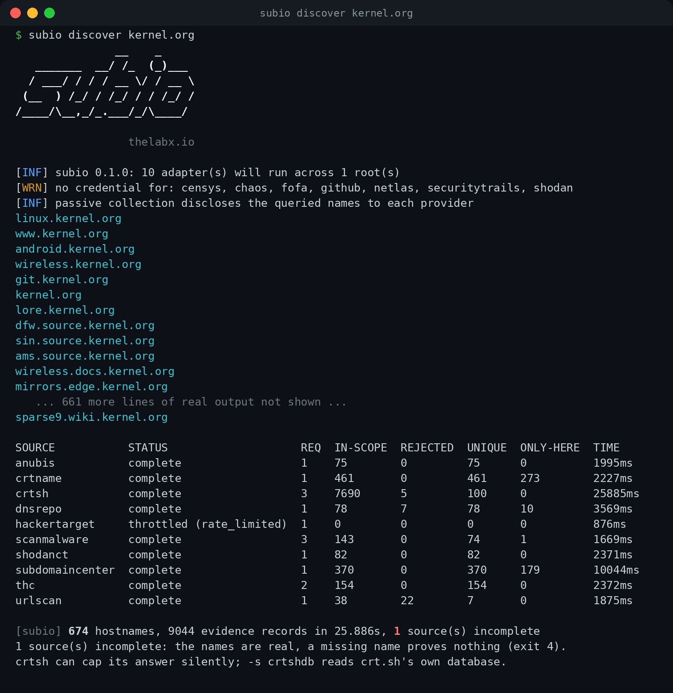

<p align="center">
  
</p>

<p align="center">
<a href="LICENSE"></a>
<a href="go.mod"></a>
<a href="https://github.com/theLabXHQ/subio/releases"></a>
<a href="go.mod"></a>
</p>

<p align="center">
  <a href="#why-subio">Why subio</a> •
  <a href="#features">Features</a> •
  <a href="#installation">Install</a> •
  <a href="#quick-start">Quick start</a> •
  <a href="#recipes">Recipes</a> •
  <a href="#sources">Sources</a> •
  <a href="#output-and-exit-codes">Output</a> •
  <a href="#documentation">Docs</a>
</p>

<p align="center"><b>Every subdomain, who reported it, and what the run failed to see.</b></p>

`subio` finds the subdomains of a domain from passive sources, and records **which
provider said what, and when**, for every name. When you are authorized, the same
run goes further: it resolves what it found with a DNS engine built for hundreds of
thousands of names, proves wildcards instead of guessing at them, and reaches the
names no index holds by guessing, walking NSEC3 chains, reading DNS records, web
pages and certificates, and probing virtual hosts.

It is one static Go binary with two `golang.org/x` dependencies. It drops into
the passive-enumeration slot of a recon pipeline, and it does one thing the rest
of that pipeline cannot: it tells you when its answer is incomplete.

<p align="center">
  
</p>

<p align="center"><sub>A real keyless run against kernel.org on 2026-11-21: 674 names from ten sources in 26 seconds. hackertarget had used up its free daily quota, so subio marked the run incomplete and exited 4. The middle of the name list is cut, and the picture says so.</sub></p>

## Why subio

Most subdomain tools answer one question: *which names exist?* subio answers the
four that come up the moment you act on the answer.

| Question | What subio does |
|---|---|
| **Where did this name come from?** | Every name joins to the provider observations behind it: the source, the evidence family (certificate, passive DNS, archive, scan engine), the provider's own timestamp, and a stable evidence id. Written as a JSON Lines ledger with a published field contract, [SCHEMA.md](SCHEMA.md). |
| **What did this run fail to see?** | Every source ends in a typed status: `complete`, `empty`, `truncated`, `partial`, `throttled`, `timed_out`, `failed`, `cancelled`. If any source is incomplete, subio **exits 4**, even under `-silent`, so a provider outage never looks like a domain with no subdomains. |
| **Did this name disappear, or did a source just fail?** | With `-store`, each run is diffed against history. A name is reported *no longer observed* only when every source that ever reported it completed this run. Otherwise it is *unconfirmed*, and the run says why. |
| **Is a resolved name real, or a wildcard?** | A signed zone's own RRSIG label count proves a wildcard expansion. Unsigned zones get control-label probes, mapped across rotating load-balancer pools until the pool stops growing, with the controls kept in the ledger for audit. |

And it stays inside the lines you draw. Scope is checked at the label boundary, so
`notexample.com` and `example.com.evil.net` are never reported for `example.com`.
In a hermetic comparison with seven other tools, four of them printed at least one
such lookalike; subio printed none. Every active method needs `-active` **and** a
written authorization record naming the roots, checked before the first packet.

## Features

<table>
<tr>
<td width="50%" valign="top">

**Passive discovery**
- 22 source adapters. **10 keyless ones run by default**, 3 slow ones with `-as`, 2 are opt-in, and 7 use your API keys.
- Per-source accounting: requests, in-scope names, rejected lines, unique names, and **ONLY-HERE**, the names no other source had.
- Typed exit codes that survive `-silent`, and a plain-words line explaining a run that found nothing.
- IDNA2008/UTS-46 normalization, wildcard-SAN handling, and label-boundary scope.
- Reads a URL or a scope-file line such as `*.example.com` as the root it names.

**DNS stage** (`-r`)
- A first-party DNS codec and pipelined UDP engine, with TCP fallback on `TC`.
- DNS-0x20 query randomisation, Extended DNS Error (RFC 8914) reporting, and kernel drop accounting.
- Per-resolver rate limits, a refusal throttle that backs off, and resolver health that forgets old history and recovers.
- A resolver profile (`-rpo`/`-rp`): resolvers that lie or stall stay out next time.
- A second resolver is asked before a known name is called non-existent.
- An RFC 2308 / 8020 negative cache that each zone must earn before it is trusted.
- `-authoritative` asks each root's own nameservers directly.

</td>
<td width="50%" valign="top">

**Active discovery** (`-active -auth`)
- Wordlist brute force: an English built-in list plus an Uzbek and Russian one, or your own.
- Permutation, with rules mined from the target's own names (shapes, number ranges, learned prefixes), ordered by measured hit rate.
- Offline NSEC3 hash-chain walking, NSEC walking and zone transfer.
- Names read from NS, MX, SOA, TXT and SRV records, and from reverse DNS.
- Certificate names from port 443, hostnames read from CSP headers, HTML and JavaScript, and virtual-host probing.
- Takes any external generator's names with `-cands`.

**More commands**
- `subio resolve`: the DNS stage alone, for any name list.
- `subio cdn`: CDN, WAF or cloud provider, from the CNAME chain and the origin AS.
- `subio asn`: an organisation, AS, address or domain mapped to its address space.
- `subio relate`: related root domains, each with its evidence.
- `subio cttail`: follow Certificate Transparency logs, tiled or RFC 6962.
- `subio nsec3`: a zone's NSEC3 posture before you walk it.
- `subio history`: inspect and maintain the run history.

</td>
</tr>
</table>

## Installation

**With Go** (1.26 or newer):

```sh
go install github.com/theLabXHQ/subio/cmd/subio@latest
```

**Prebuilt binaries** for Linux, macOS and Windows (amd64 and arm64), with
`SHA256SUMS`, are on the [releases page](https://github.com/theLabXHQ/subio/releases).

**From source:**

```sh
git clone https://github.com/theLabXHQ/subio && cd subio
make build          # ./subio
make dist           # all six platforms, reproducible, checksummed
```

subio links two modules, both BSD-3-Clause: `golang.org/x/net` and
`golang.org/x/text`. Everything else, including the DNS wire codec, is
first-party.

## Quick start

```sh
subio discover example.com                         # passive, keyless, about a minute
subio discover example.com -src -ec                # show which sources reported each name
subio discover -l roots.txt -j -o names.jsonl      # many roots, JSON Lines out
subio discover example.com -ledger run.ledger.jsonl -m run.manifest.json   # full evidence
subio discover example.com -store ./state -co      # only what changed since last time
subio sources                                      # adapters, keys and terms, offline
```

API keys come from `SUBIO_KEY_<ADAPTER>` in the environment, from a mode-600 file
passed with `-sf`, or from the common names already in your shell (`GITHUB_TOKEN`,
`SHODAN_API_KEY` and others). A keyed adapter without a key is skipped, and the run
says which ones were.

<details>
<summary><b>All flags of <code>subio discover</code></b></summary>

```text
subio discover - collect subdomains from passive sources

USAGE
   subio discover example.com [more.com ...] [flags]
   subio discover -l roots.txt -j -o findings.jsonl

Passive collection sends requests to third-party providers, which discloses
the names you are researching to them. -resolve additionally queries the
target's nameservers, which is active: use it only where you are authorized.

Names are reported as evidence. subio never claims a name is live, owned or
reachable, and an incomplete source run is reported as incomplete rather than
rendered as "these names are gone".

INPUT:
   -d, -domain string                  root domain to enumerate; repeatable and comma separated
   -l, -list file                      file of root domains, one per line; - for stdin

SOURCES:
   -s, -source string                  only these adapters (default: every enabled one but the slow ones)
   -as, -all-sources                   also run the slow adapters - wayback, commoncrawl, certspotter - which cost minutes for a few names
   -es, -exclude-source string         skip these adapters
   -p, -profile string                 terms profile: personal or commercial
   -sf, -secrets-file string           file of `source_id = value` lines; mode must be 600

OUTPUT:
   -o, -output string                  write results to this file as well as stdout
   -of, -output-format string          output format: plain, jsonl or csv
   -j, -jsonl                          shorthand for -of jsonl
   -csv                                shorthand for -of csv
   -ledger string                      write the full evidence ledger (findings, evidence, DNS, diagnostics) here
   -m, -manifest string                write a run manifest here
   -scope-id string                    label recorded in the manifest instead of a hash of the roots
   -sorted                             emit results sorted by name instead of streaming them as found

HISTORY:
   -store string                       directory holding run history; enables the diff
   -co, -changed-only                  print only new, returning, DNS-changed or no-longer-observed names
   -retire-after int                   drop assets unseen for this many consecutive complete runs; 0 keeps all
   -compact                            rewrite the logs after committing
   -ch, -show-change                   show each name's change against the history

DISPLAY FIELDS:
   -a, -all                            show every field below
   -src, -show-sources                 show which adapters reported the name
   -fam, -show-families                show the evidence families
   -ec, -evidence-count                show the evidence record count
   -fs, -first-seen                    show the earliest provider-stated time
   -ls, -last-seen                     show the latest provider-stated time
   -st, -status                        show the DNS verification status
   -dns, -records                      show the answer records
   -cn, -cname                         show the CNAME chain
   -rc, -rcode                         show the DNS response code
   -rsv, -show-resolver                show which resolver answered
   -wc, -wildcard-mark                 mark names explained by a wildcard zone
   -rt, -show-root                     show the authorization root
   -eg, -edge                          show the CDN, WAF or cloud provider in front of the name

DNS STAGE (ACTIVE):
   -r, -resolve                        query DNS for every discovered name; this is ACTIVE
   -cdn                                with -resolve, also ask Team Cymru which AS routes each address, to mark CDN, WAF and cloud edges a CNAME does not reveal; one DNS query per distinct address
   -rs, -resolvers string              resolvers, comma separated, or @file
   -rp, -resolver-profile string       a resolver profile an earlier run wrote: leave out the resolvers it dropped and start the ones it slowed at their measured rate
   -rpo, -resolver-profile-out string  write what this run learned about each resolver, for -rp next time; carries over the entries of -rp it did not re-measure
   -ty, -types string                  record types to query (default A)
   -qps int                            global DNS queries per second ceiling; 0 is unlimited (default 1000)
   -rqps, -resolver-qps int            per-resolver queries per second ceiling; 0 is unlimited. Bounds each resolver so a global rate split over a public list does not push one past its own limit
   -dw, -dns-workers int               DNS sockets (default 16)
   -dn, -dns-window int                outstanding queries per DNS socket (default 256)
   -dt, -dns-timeout duration          per-query timeout (default 2s)
   -dr, -dns-retries int               DNS retries after the first attempt (default 1)
   -no-tcp                             do not retry truncated answers over TCP
   -no-wildcard                        do not probe for wildcard zones
   -wn, -wildcard-controls int         random control labels per wildcard probe (default 3)
   -authoritative                      query each root's own nameservers directly instead of a recursive resolver; removes a lying or rate-limited middleman and cache staleness. All load lands on the target

ACTIVE DISCOVERY (AUTHORIZED TARGETS ONLY):
   -active                             allow the methods below; they guess at names on the target's nameservers
   -auth string                        record naming these roots and allowing active-dns; required by -active
   -brute                              ask a wordlist under each root (built-in list unless -w is given)
   -w, -wordlist file                  wordlist for -brute, one label per line; repeatable
   -uz, -uzbek                         also use the built-in Uzbek and Russian label list with -brute
   -permute                            ask variations of known names
   -pw, -permute-words string          extra words for -permute, one per line
   -cands, -candidates file            file of full candidate names to resolve, one per line, from any external generator; repeatable
   -mine                               read each root's NS, MX, SOA, TXT and SRV records for names
   -axfr                               try a zone transfer from each root's nameservers
   -nsec                               walk each root's NSEC chain, where the zone exposes one
   -ptr                                read reverse DNS of the addresses found
   -tls                                read certificate names from found hosts on port 443; needs active-tls
   -web                                read hostnames the found hosts' pages and headers reference (CSP, links); needs active-http
   -vhost                              probe found addresses for virtual hosts that serve a distinct site with no DNS record; needs active-http
   -active-all                         turn on every method that needs only active-dns: brute, permute, mine, nsec, ptr, axfr
   -depth int                          with -brute, also ask under found names this many levels down (default 1)
   -max-candidates int                 ceiling on generated names per run (default 5000000)
   -trusted string                     keep a generated name only if these resolvers confirm it
   -trusted-qps int                    queries per second to -trusted resolvers (default 100)
   -no-0x20                            turn off DNS-0x20: send query names in lower case instead of mixed case
   -nnc, -no-negative-cache            ask every query; by default a name at or beneath one just answered NXDOMAIN is answered NXDOMAIN without asking, once its zone has kept that rule (RFC 8020) when checked

LIMITS:
   -t, -timeout duration               overall run deadline (default 10m0s)
   -c, -concurrency int                global in-flight HTTP requests (default 16)
   -ps, -per-source int                in-flight HTTP requests per adapter (default 2)

DIAGNOSTICS:
   -silent                             only results on stdout, nothing on stderr
   -v, -verbose                        verbose diagnostics
   -no-stats                           do not print the per-source report
   -nc, -no-color                      disable color

EXIT CODES
   0  success
   1  fatal error
   2  configuration error (nothing was queried)
   3  completed, found nothing
   4  completed, but a source's results are incomplete or a DNS query went unanswered

EXAMPLES
   subio discover example.com
   subio discover example.com -src -ec
   subio discover example.com -s crtsh,wayback -j -o run.jsonl -ledger run.ledger.jsonl
   subio discover example.com -r -ty A,AAAA,CNAME -qps 5000 -dns -st
   subio discover -l roots.txt -m run.manifest.json -of csv -o findings.csv
   subio discover example.com -active -auth auth.json -brute -permute -mine
```

</details>

## Recipes

### In a pipeline

subio prints one lowercase name per line on stdout, and diagnostics on stderr.
`-silent` leaves only the names.

```sh
subio discover example.com -silent | anew known.txt | notify
subio discover example.com -silent | dnsx -silent -a -resp | httpx -silent -title -tech-detect
```

The exit code is the part a pipeline usually throws away, and the part worth keeping:

```sh
subio discover example.com -silent > names.txt
case $? in
  0) ;;                                                    # complete
  3) echo "nothing found" >&2 ;;                            # an answer, not an error
  4) echo "INCOMPLETE: a source or a query failed" >&2 ;;   # real names, partial set
  *) echo "run failed" >&2; exit 1 ;;
esac
```

### Monitoring a domain over time

```sh
subio discover example.com -store ./state -co -nc
```

<details>
<summary>A real second run against wikipedia.org, the day crt.sh was down</summary>

```text
changes since run 03793ed3fc8b2554:
  new                  197
  unchanged            1170
  new                0jffoder4hxqbohybrtuh42w2g.wikipedia.org
  new                20e.wikipedia.org
  ...
This diff is not conclusive: crtsh=failed, dnsrepo=truncated, hackertarget=truncated, subdomaincenter=truncated.
New and changed names above are real. An absence is only reported where every
source that had ever found the name completed this run.
```

crt.sh was failing at the time, so the run exited 4, and none of the names crt.sh
had reported before was called gone.

</details>

### Evidence for every name

```sh
subio discover example.com -j                       # JSON Lines, with sources and evidence count
subio discover example.com -ledger run.ledger.jsonl # every observation, DNS answer and source run
```

<details>
<summary>One real JSON record</summary>

```json
{"schema_version":"subio.v2","timestamp":"2026-11-20T22:54:16.436453601Z","host":"0uexbnqtw4nurjctllqm10nzuf.wikipedia.org","root":"wikipedia.org","sources":["subdomaincenter"],"families":["curated-dataset"],"evidence_count":1,"verification_status":"not_checked"}
```

The ledger adds one `evidence` record per provider observation, one
`dns_observation` per answer, and one `source_run` per adapter, with its status,
request count and error class. Every field is documented in [SCHEMA.md](SCHEMA.md).

</details>

### Resolve, with proof of wildcards

```sh
subio discover example.com -r -ty A,AAAA,CNAME -dns -st     # observe DNS for what was found
subio discover example.com -r -rs @resolvers.txt -rqps 50 -rpo profile.json
subio resolve -l names.txt -qps 5000 -j                     # the DNS stage alone
```

`-r` is active: it queries the target's nameservers through your resolvers. Run it
only where you are authorized. See [The DNS stage](docs/dns.md).

### Active discovery, on targets you are authorized to test

```sh
cp examples/authorization.template.json auth.json   # name the roots, the methods and an expiry
subio discover example.com -active -auth auth.json -active-all
subio all example.com -auth auth.json               # every method the record allows
```

See [Active discovery](docs/active.md) for what each method sends, and why.

### Edges, origins and address space

```sh
subio cdn -i www.example.com,api.example.com
subio asn -i example.com -agg
subio asn -i AS13335 -c
```

<details>
<summary>Real output</summary>

```text
INPUT              KIND   PROVIDER  VIA
www.mozilla.org    cdn    fastly    asn AS54113
www.kernel.org     cdn    fastly    cname dualstack.m.sni.global.fastly.net
git.kernel.org     cloud  linode    asn AS63949
www.wikipedia.org  -      -         not_identified

4 input(s): 2 cdn, 0 waf, 1 cloud, 0 failed.
```

```text
[WRN] AS63949 AKAMAI-LINODE-AP - Akamai Connected Cloud, SG belongs to linode (cloud), not to kernel.org: printing only the 2 range(s) holding its address(es); -whole-as maps the provider's whole AS
172.105.0.0/19
2600:3c04::/32
```

A domain hosted in a cloud provider's network gets the range that holds its own
address, not the provider's entire AS, which is a list someone would otherwise go
on to scan.

</details>

### Related roots, certificate logs, NSEC3

```sh
subio relate -d example.com                    # sibling brands and acquisitions, with evidence; never enumerated
subio cttail -d example.com -store ./ct        # new certificates for your scope, as they are logged
subio nsec3 -d example.com                     # is this zone worth walking?
```

## Sources

| Adapter | Family | Key | Default |
|---|---|:---:|:---:|
| `crtsh` | certificate transparency | — | yes |
| `crtname` | certificate transparency | — | yes |
| `scanmalware` | certificate transparency | — | yes |
| `shodanct` | certificate transparency | — | yes |
| `anubis` | curated dataset | — | yes |
| `subdomaincenter` | curated dataset | — | yes |
| `hackertarget` | passive DNS | optional | yes |
| `dnsrepo` | passive DNS | — | yes |
| `thc` | passive DNS | — | yes |
| `urlscan` | scan engine | — | yes |
| `wayback` | web archive | — | `-as` |
| `commoncrawl` | web archive | — | `-as` |
| `certspotter` | certificate transparency | optional | `-as` |
| `crtshdb` | certificate transparency (crt.sh's database) | — | `-s` only |
| `sitedossier` | curated dataset | — | `-s` only |
| `censys` | scan engine | required | with key |
| `fofa` | scan engine | required | with key |
| `shodan` | scan engine | required | with key |
| `netlas` | scan engine | required | with key |
| `securitytrails` | passive DNS | required | with key |
| `chaos` | curated dataset | required | with key |
| `github` | code search | required | with key |

Every keyless adapter has answered live runs. The keyed ones follow each provider's
documentation and official client, and have not yet been run against their live
APIs. Each adapter's documented limit, terms state and review date are in
`subio sources`, and in [docs/sources.md](docs/sources.md).

## Output and exit codes

| Format | Flag | Notes |
|---|---|---|
| plain | default | one name per line; streams as names arrive; `-a` adds every field |
| JSON Lines | `-j` | one record per name, with sources, families, evidence count, provider times and DNS answers |
| CSV | `-csv` | the same fields; formula injection neutralized |
| ledger | `-ledger file` | every observation, DNS answer, disagreement and source run ([SCHEMA.md](SCHEMA.md)) |
| manifest | `-m file` | what was asked, with which flags, and what each source did |

| Code | Meaning |
|---:|---|
| 0 | success |
| 1 | fatal error |
| 2 | configuration error; nothing was queried |
| 3 | completed, found nothing |
| 4 | completed, but a source's results are incomplete or a DNS query went unanswered |

A free plan's fixed row ceiling, such as hackertarget's 50 keyless rows, is
reported as `truncated (plan_limit)` but does not cause exit 4. Every keyless run
hits that ceiling the same way, so it says nothing about this run.

## Documentation

| | |
|---|---|
| [Principles](docs/principles.md) | what subio reports, and what it deliberately will not do |
| [Sources](docs/sources.md) | every adapter, its limits, credentials and terms profiles |
| [The DNS stage](docs/dns.md) | the resolver, wildcards, negative caching and resolver profiles |
| [Active discovery](docs/active.md) | brute force, permutation, NSEC3 and the web layer, and the authorization record |
| [Output](docs/output.md) | formats, exit codes and pipelines |
| [Monitoring](docs/monitoring.md) | `-store`, diffs, retirement and history |
| [Certificate transparency](docs/cttail.md) | `subio cttail` |
| [Related roots](docs/relate.md) | `subio relate` |
| [Edges and address space](docs/cdn-asn.md) | `subio cdn` and `subio asn` |
| [NSEC3 posture](docs/nsec3.md) | `subio nsec3` |
| [Benchmarks](docs/benchmarks.md) | how subio was measured against other tools |
| [SCHEMA.md](SCHEMA.md) | the field contract of every record subio writes |

## Responsible use

Passive collection sends the names you research to third-party providers. `-r`
and every active method send traffic to the target's infrastructure. subio
refuses active work without a written authorization record that names the roots,
the methods and an expiry. It never widens that scope by itself, and it suggests
related roots without querying them. Use it on what you own or are authorized to
test.

## License

MIT, see [LICENSE](LICENSE). Made by [theLabX](https://thelabx.io).
